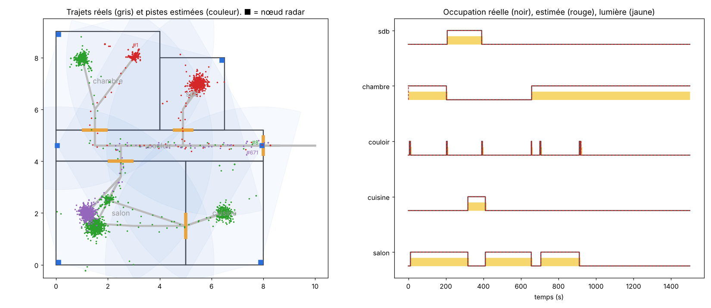
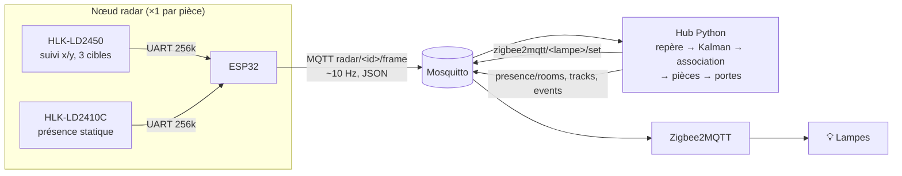

# radar-presence

**Suivi de personnes dans un appartement par radar mmWave. Allume la lumière
quand une personne passe une porte. Garde la présence d'une personne immobile.**

Pas de caméra, pas de badge. Un nœud radar par pièce (ESP32 + 2 radars 24 GHz),
un hub (Raspberry Pi ou PC) qui suit chaque personne sur le plan de
l'appartement, et Zigbee2MQTT pour les lampes.



Schéma animé du fonctionnement : [`docs/fonctionnement.html`](docs/fonctionnement.html)
(à ouvrir dans un navigateur).

> L'ancienne version de ce dépôt (détection par Wi-Fi CSI) est conservée sous le
> tag [`wifi-csi-archive`](../../tree/wifi-csi-archive).

---

## Statut

| Partie | État |
|---|---|
| Logique de suivi, pièces, lumières (Python) | Validée **en simulation** (12 tests, 16 graines aléatoires) |
| Firmware ESP32 | **Compile** (PlatformIO, ESP32 DevKit). Non testé sur radars réels |
| Décodeurs LD2450 / LD2410C | Testés contre l'exemple du manuel Hi-Link (Python et C++) |
| Essai dans un vrai appartement | **Pas encore fait** |

Les chiffres ci-dessous disent « la logique fait ce qu'il faut avec un modèle
de capteur pessimiste ». Ils ne sont pas une performance terrain. Le modèle de
capteur du simulateur repose sur des hypothèses listées dans `hub/presence/sim.py`
(taux de détection, fantômes, bruit). Ces hypothèses sont à mesurer en TP.

Résultats simulés (scénario par défaut : 3 personnes, 25 min, 5 pièces, 16 graines) :

| Indicateur | Valeur |
|---|---|
| Temps où le nombre de personnes par pièce est exact | 99,86 % à 99,94 % |
| Personne présente, lumière éteinte (> 1 s après l'entrée) | 0 s sur 15 graines, 1,4 s sur 1 graine |
| Lumière allumée, pièce vide (> délai + 3 s) | 0 à 8,3 s par scénario |
| Changements d'identité | 0 sur 15 graines, 1 sur 1 graine |

---

## Pourquoi deux radars par pièce

Le cahier des charges a deux exigences qui s'opposent :

1. **Suivre chaque personne** (position, identité, passage de porte).
2. **Savoir qu'une personne immobile est là** (lecture, sommeil).

| Capteur | Fait bien | Fait mal |
|---|---|---|
| **HLK-LD2450** (24 GHz, suivi) | Position x/y de 3 cibles, ~10 Hz, ±60°, ~6 m | Perd souvent une personne parfaitement immobile |
| **HLK-LD2410C** (24 GHz, présence) | Détecte la respiration : présence statique fiable | Pas de position (une distance), pas d'identité |
| PIR | Pas cher | Aveugle à l'immobilité. Exclu |
| Wi-Fi CSI (`human-sensing`) | Présence par pièce sans capteur dédié | Ne sépare pas les individus. Pas de passage de porte |

Le système combine les deux radars avec une règle simple : **la conservation des
personnes**. Une personne n'apparaît pas et ne disparaît pas au milieu d'une
pièce. Elle entre ou sort par une porte.

- Le LD2450 perd une personne **loin d'une porte** → elle s'est arrêtée.
  La piste reste, gelée sur place (état `immobile`).
- Le LD2450 perd une personne **près d'une porte** → elle est peut-être sortie.
  La piste attend 3 s qu'un nœud voisin la reprenne (« handoff »). Sinon, sortie.
- Seul le LD2410C peut libérer une piste immobile : il doit ne voir **personne**
  dans la pièce pendant 45 s.

---

## Architecture



Traitement sur le hub, pour chaque trame d'un nœud :

1. **Repère** : coordonnées capteur → coordonnées appartement (pose du nœud).
2. **Filtre « pièce »** : on rejette les cibles hors de la pièce du nœud. Le
   24 GHz traverse en partie les cloisons.
3. **Prédiction** : filtre de Kalman, modèle vitesse constante.
4. **Association** : distance de Mahalanobis + algorithme hongrois. Les pistes
   confirmées choisissent avant les pistes provisoires.
5. **Cycle de vie** : `provisoire → confirmée → immobile / à la porte → supprimée`.
6. **Pièces** : changement de pièce seulement par une porte, avec 3 mesures de
   l'autre côté (hystérésis).
7. **Lumières** : allumage à l'entrée dans la pièce. Extinction 5 s après que la
   pièce devient vide.

---

## Matériel

Prix : **estimations non vérifiées** (ordre de grandeur, novembre 2026). Vérifier chez votre fournisseur.

| Élément | Qté | Prix unitaire estimé |
|---|---|---|
| HLK-LD2450 | 1 par pièce (2 pour un couloir long) | 10–20 € |
| HLK-LD2410C | 1 par pièce | 4–10 € |
| ESP32 DevKit (ESP32-WROOM-32) | 1 par nœud | 6–12 € |
| Alimentation USB 5 V ≥ 1 A | 1 par nœud | 5–10 € |
| Raspberry Pi 4/5 ou mini-PC (hub) | 1 | 50–100 € |
| Clé Zigbee (coordinateur compatible Zigbee2MQTT) | 1 | 20–35 € |
| Ampoules ou modules Zigbee | 1 par pièce | 10–20 € |

Pour l'appartement d'exemple (5 pièces, 6 nœuds) : environ 250–450 € hors
ampoules. **Estimation, confiance moyenne.**

### Câblage d'un nœud

| Radar | Broche radar | ESP32 |
|---|---|---|
| LD2450 | 5V / GND | 5V (VIN) / GND |
| LD2450 | TX | GPIO16 (RX2) |
| LD2450 | RX | GPIO17 (TX2) |
| LD2410C | VCC / GND | 5V (VIN) / GND |
| LD2410C | TX | GPIO18 (RX1) |
| LD2410C | RX | GPIO19 (TX1) |

Alimentation 5 V, niveaux logiques UART 3,3 V : compatibles ESP32 sans
adaptateur. **À vérifier sur le manuel de votre révision de module avant de
câbler (confiance ~85 %).**

### Pose des nœuds

- Hauteur 1,5–2 m, dans un coin, axe de visée vers le centre de la pièce.
- **Toutes les portes de la pièce dans le champ** (±60°, < 6 m). Le passage de
  porte est l'événement le plus important du système.
- Éviter un ventilateur, un rideau devant une fenêtre ouverte, un aquarium dans
  le champ. Sinon, déclarer une zone `exclude` dans la configuration.
- Couloir de plus de 6 m : deux nœuds, un à chaque bout (le hub fusionne).
- LD2450 et LD2410C côte à côte : **risque d'interférence entre deux radars
  24 GHz non vérifié**. Tester avec 10–20 cm d'écart et des orientations
  légèrement différentes. Si gêne : n'utiliser que la sortie OUT du LD2410C, ou
  un LD2410C par pièce posé ailleurs.

---

## Installation

### Hub

```bash
cd hub
pip install -r requirements.txt
cp config.example.yaml config.yaml      # décrire VOTRE appartement
python -m pytest -q                     # 12 tests
python -m presence sim --plot sim.png   # scénario simulé + figure
```

Prérequis réseau : un broker MQTT (Mosquitto) et Zigbee2MQTT déjà en place.

```bash
python -m presence -v --config config.yaml run --dry-run  # suivi réel, sans piloter les lampes
python -m presence --config config.yaml run                # en production
```

Le hub publie :

- `presence/rooms/<pièce>` → `{"occupancy": 2, "light": true}` (retenu)
- `presence/tracks` → positions et états des pistes, 1 Hz
- `presence/events` → entrées, sorties, naissances, fins de pistes

### Nœuds

```bash
cd firmware
cp include/config.example.h include/config.h   # Wi-Fi, MQTT, NODE_ID
pio run -e esp32dev -t upload
pio device monitor                             # santé toutes les 10 s
```

### Calibrer la pose d'un nœud

La pose (x, y, angle) d'un nœud doit être précise : une erreur de 5° donne
50 cm d'erreur à 6 m.

1. Poser 5–8 repères au sol, mesurés au mètre ruban dans le repère appartement.
2. Se tenir sur chaque repère 5 s. Noter la moyenne de x, y renvoyée par le nœud
   (`presence serial` ou `mosquitto_sub -t radar/<id>/frame`).
3. Écrire un CSV `xs_mm,ys_mm,x_monde_m,y_monde_m`, puis :

```bash
python -m presence calibrate points_salon.csv
# pose: [0.112, 0.087, 44.2]   rmse = 9.8 cm
```

---

## Limites connues

- **3 cibles maximum par LD2450.** Au-delà de 3 personnes dans le champ d'un
  nœud, des personnes manquent. Une fête à 8 dans le salon dépasse le système.
- **Deux personnes à moins de ~50 cm** (côte à côte sur un canapé) peuvent
  fusionner en une cible. Cause : résolution en distance d'un radar 24 GHz
  limitée par la bande ISM de 250 MHz (c/2B = 0,6 m). Le comptage peut alors
  être faux. Les lumières, elles, restent justes : la pièce reste occupée.
- **Un fantôme confirmé dans une pièce occupée** peut y rester jusqu'à ce que
  la pièce se vide. Effet : la lumière s'éteint jusqu'à 45 s plus tard.
- **Entrée non vue** (porte hors du champ, personne entrée pendant une panne) :
  la piste naît plus tard, loin de la porte, avec plus de preuves exigées.
  Retard possible d'allumage de quelques secondes.
- **Identité anonyme.** Le système sait « piste 12 », pas « Alice ». Nommer les
  personnes demande un autre capteur (téléphone en BLE, par exemple).
- **Hypothèses du simulateur non mesurées.** Voir `hub/presence/sim.py`.

---

## Arborescence

```
radar-presence/
├── firmware/                 ESP32 (PlatformIO)
│   ├── include/radar_parsers.h   décodeurs LD2450 / LD2410C (C++ pur, testables sur PC)
│   ├── src/main.cpp              lecture UART + publication MQTT
│   └── test/test_parsers.cpp
├── hub/                      Python
│   ├── config.example.yaml       plan de l'appartement, nœuds, réglages
│   ├── presence/
│   │   ├── geometry.py           repères, polygones, calibration (Kabsch 2D)
│   │   ├── protocol.py           décodeurs Python (TP sans ESP32)
│   │   ├── tracker.py            Kalman + association + cycle de vie
│   │   ├── engine.py             nœuds -> suivi -> pièces -> lumières
│   │   ├── mqtt_io.py            MQTT et Zigbee2MQTT
│   │   └── sim.py                simulateur + métriques + figure
│   └── tests/
└── docs/
    ├── TP_M2.md              projet pédagogique (Master 2 électronique)
    └── simulation.png
```

Licence : MIT.
