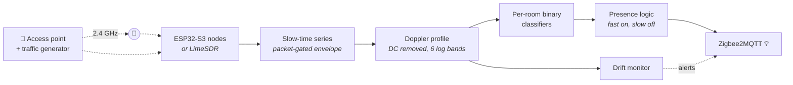

<div align="center">

# human-sensing

**Room-level presence detection from Wi-Fi channel perturbations — no cameras, no wearables.**

Turns the radio noise already flooding your home into an occupancy signal, and drives
your Zigbee lights with it. Built to fix the one thing motion sensors get wrong:
switching the light off because you stopped moving.

[](LICENSE)
[](https://www.python.org/)
[](https://scipy.org/)
[](#validation)
[](#status)

</div>

---

## Status

**Validated in simulation. Not yet run against real hardware.**

Every algorithm below is exercised end-to-end by a synthetic Wi-Fi generator that
produces real packet bursts, correlated multi-occupant motion and machine
signatures — but synthetic data is not a substitute for a real apartment. Treat
the numbers in this README as *"the maths separates the cases it should"*, not as
field performance.

That distinction matters more than it sounds. Published CSI-sensing demos routinely
report 100 % accuracy on a few hundred samples captured in a single room during a
single session; those models have learned the session, not the phenomenon. Numbers
here are reported the same way they were measured, with the failure modes attached.

---

## What it actually measures

A human body is a strong scatterer at 2.4 GHz — that is literally why microwave
ovens run at 2.45 GHz. But the system does not measure absorption. It measures
**interference**: the received signal is the coherent sum of dozens of paths, and
what we track is how a body perturbs that sum.

The wavelength is 12.5 cm. A path lengthened by 6 cm flips the phase 180° and turns
constructive interference into destructive. That extreme sensitivity is what makes
a 5 mm chest movement detectable — and it is also why moving a sofa invalidates a
calibration. Same coin, both faces.



Everything runs on the **slow-time series** — one channel-gain value per tick
(20–100 Hz). That is where the information lives, not in raw I/Q samples.

---

## Quick start

No hardware required to try it.

```bash
git clone https://github.com/Vinh-HK/human-sensing && cd human-sensing
./install.sh                       # add --sdr for LimeSuite/SoapySDR
python -m wifisense selftest       # 12 checks against the simulator
```

### Guided setup

Nothing is hardcoded — any number of rooms, any number of nodes. The wizard asks
what you have and writes a commented `config.yaml`, then prints the exact
calibration plan for *your* rooms:

```bash
python -m wifisense setup
```

```
── Hardware ──
  Sensor type (esp32csi/limesdr/fake) [esp32csi] :
── Rooms ──
  How many rooms to cover [4] :
  Name of room 1 : Bathroom
    Zigbee2MQTT lights for "bathroom" [lamp_bathroom] :
    Delay before switching off (s) [90] :
  …
  → 4 nodes: classifier mode (rejects inter-room leakage,
    handles multiple occupants). Default threshold 4 dB.
```

Room presets are applied automatically — a bedroom or living room gets a long
hold time (that being the whole point), a bathroom a shorter one. With a single
node it falls back to a scalar detector, because there is no multi-node vector to
classify.

Add `--defaults` for a non-interactive run; the wizard also accepts piped answers
so it can be scripted.

### Check before you calibrate

A calibration session costs five minutes and requires leaving the apartment.
Discovering afterwards that one node was silent is the worst outcome — so verify
the whole chain first:

```bash
python -m wifisense doctor
```

```
── CSI nodes (listening 10 s) ──
  [✓] node 0 — 21 frames/s
  [✓] node 1 — 20 frames/s
  [!] node 2 — 3 frames/s — too few, enable the traffic generator
  [✗] node 3 — declared in config but silent
── Zigbee2MQTT ──
  [✓] bridge online
  [✗] lights not found — lamp_kitchen
```

It walks the chain in flow order: dependencies → sensors → data actually
arriving → broker → model, and exits non-zero on anything blocking.

### Then

```bash
python -m wifisense monitor                          # live scores, drives nothing
python -m wifisense calibrate --label empty          # everyone out
python -m wifisense calibrate --label kitchen        # …one session per room
python -m wifisense calibrate --label kitchen,living # …plus real two-person cases
python -m wifisense fit                              # train, print separability
python -m wifisense run                              # daemon
```

---

## Hardware

| | LimeSDR Mini | LimeSDR-USB | **ESP32-S3** |
|---|---|---|---|
| Price | ~180 € | ~350 € | **~8 €/node** |
| Info per packet | 1 power scalar | 1 power scalar | **56 complex subcarriers (CSI)** |
| Streams | **1** → one zone | 2 | **1 per node** |
| Getting CSI | demodulate 802.11 yourself | same | **done in firmware** |
| 5 GHz band | out of reach (3.5 GHz max) | out of reach (3.8 GHz) | depends on chip |

**For multi-room automation, cheap distributed nodes beat one good radio.** One
antenna is one measurement point, and 2.4 GHz walks straight through interior
walls — no amount of processing separates rooms from a single vantage point. An
SDR remains useful for spectrum diagnostics.

Compatible CSI firmware: [RuView `esp32-csi-node`](https://github.com/ruvnet/RuView).
The UDP frame parser in [`sources/esp32csi.py`](wifisense/sources/esp32csi.py)
implements its ADR-018 binary format.

> **Note** — that frame format carries no transmitter MAC, so N nodes yield N
> streams, not N(N−1) links. Per-link separation would need a firmware change.

---

## Three detectors, three failure modes

Each returns a score in dB, compared against `baseline + threshold_db` where the
baseline comes from calibration. Uniform scale, uniform calibration, interchangeable.

| Detector | Principle | Window |
|---|---|---|
| `shower` | envelope variance after 0.3–20 Hz bandpass | 4 s |
| `breathing` | spectral line at 0.13–0.60 Hz + frequency-stability test | 60 s |
| `kitchen` | residual after adaptive spectral background subtraction | 10 s |

### Breathing is not Doppler

Doppler shift at 2.4 GHz is ≈ **16 Hz per m/s**. A chest wall moves at ~0.01 m/s →
0.15 Hz. That is not an exploitable shift; it is **phase modulation** of the channel.

Hence the 60 s window: frequency resolution is 1/T, so resolving a 0.25 Hz line on
a short block is impossible in principle, not just in practice.

### Why "filter out everything above 300 Hz" cannot reject appliances

A washing-machine drum on spin (1200 rpm) does land near 500 Hz. But **the same
drum during the wash cycle turns at ~50 rpm and lands near 20 Hz** — squarely
inside the human band. No fixed cutoff separates them.

The real difference is elsewhere: a machine is **stationary** (stable spectrum for
minutes), a human is **transient**. So the detector keeps a rolling spectral
background and only fires on what exceeds it.

That background adapts **asymmetrically**, and this is the subtle part. A symmetric
background eventually absorbs the person you are looking for: start the daemon
while someone is in the room, they become the background, are therefore never
detected, so nothing freezes the learning, so they keep being absorbed — a
self-sustaining failure. Therefore:

- **fast decay** (`bg_fall_s`, 20 s) — the room quietens, the detector rearms;
- **slow rise** (`bg_rise_s`, 10 min) — a presence is never absorbed quickly;
- **rise frozen** while presence is asserted; decay always allowed.

Accepted trade-off: when a dishwasher starts, its spectrum takes ~10 minutes to be
absorbed, so a light may stay on too long *once*. Missing a human is far worse.

---

## Room classification

With several nodes, thresholds per node are not enough. Each room gets an
**independent binary classifier fed by the feature vector of every node**.

Why not a single "which room is the person in?" classifier: because homes have
several occupants. A single label assumes one person, and "someone in the kitchen
AND someone in the living room" appears in no reasonable training set — there are
2ⁿ combinations. So we ask n binary questions.

The decisive advantage over thresholds lies elsewhere: by training on "someone in
the living room" sessions as **negative** examples for the kitchen, the kitchen
classifier learns what living-room leakage looks like, and rejects it. A local
threshold has no way to make that distinction.

> **This is not triangulation.** No distance is measured — range resolution is
> `c/2B`, i.e. **7.5 m** on a 20 MHz channel, larger than most rooms. The system
> recognises a fingerprint. It will never say "2.3 m from node A", and it must be
> recalibrated when large furniture or the router moves.

Method: Fisher linear discriminant with regularised covariance. No neural network,
deliberately — with a few hundred examples across 24 dimensions, a regularised
linear model generalises across days better than a network that will memorise the
recording session.

### Multi-occupant sessions are not optional

Trained on single-occupancy data only, the kitchen score in simulation falls from
**9.6 dB alone to 6.9 dB** when someone is in the living room, and to **5.7 dB**
with three people — barely above threshold.

It is mechanical: the kitchen discriminant carries negative weights on living-room
features — that is exactly what rejects leakage — so *genuine* living-room activity
also erodes its score. A threshold tuned on single occupancy produces **misses as
soon as two people are home**.

Adding two two-person sessions brings those same cases back to **9.1** and
**9.2 dB**. Record the combinations that actually happen in your home, not all 2ⁿ.

### Reading the `fit` report

The **Fisher ratio** measures each room's separability:

| Ratio | Verdict |
|---|---|
| ≥ 3 | excellent |
| ≥ 2 | acceptable |
| ≥ 1 | weak |
| < 1 | unusable — **move the node**, don't touch the threshold |

---

## Drift monitoring

A fingerprint model expires. Not abruptly — gradually, and silently. So the system
watches its own decay, along two axes that must be measured separately.

**During empty periods** — with nobody home every score should sit near 0 dB.
Departure means the channel itself changed: dead node, gain drift, collapsed
traffic, new interferer.

**During active periods** — this is what catches moved furniture. Empty-period
monitoring structurally cannot: with no motion, the score is 0 dB before *and*
after the sofa moves. What changed is the mapping "person in the living room →
fingerprint", and that is only observable while someone is there.

### Why measuring confidence does not work

This is the trap, and it is instructive. After a rearrangement, someone in the
living room may start to *look like* the kitchen. The kitchen classifier then fires
**strongly**: high score, clean margin, and every confidence metric declares the
model healthy. It is comfortably wrong.

In simulation, a substantial living-room rearrangement drops the best room score by
only **1.7 dB** — undetectable by any sane threshold.

The metric that works consults no discriminant at all: the **distance to the nearest
calibrated situation**. The observed vector drifts away from *every* learned
centroid, because it no longer resembles anything in the training set. On the same
scenario that distance goes from ×1.10 (control, nothing moved) to **×1.69**, well
clear of the ×1.4 alert threshold.

Alerts are logged and published to MQTT (`wifisense/drift`):

```json
{"kind": "attribution", "severity": "warn",
 "message": "Measurements no longer resemble any calibrated situation (×1.69)…"}
```

What it will not catch: a chair moved 20 cm. Which is fine — that does not break the
model either.

### No silent retraining

`drift.auto_collect` (off by default) accumulates "empty" samples during quiet
periods and appends them to the dataset. It **never retrains by itself**: if a
"quiet" period actually contained someone asleep, silent retraining would destroy
the system with nobody noticing. `fit` stays a deliberate act.

---

## Calibration

Scores are in dB, but their absolute scale depends on the room, the gain, the
antenna position and the traffic level. A hardcoded threshold would transfer
nowhere.

```bash
python -m wifisense calibrate --label empty    --duration 300
python -m wifisense calibrate --label machine  --duration 300   # empty + appliance running
python -m wifisense calibrate --label bedroom  --duration 300
```

The reference is the **95th percentile**, not the maximum: the maximum is set by the
single worst artefact of the whole session, which would make the threshold hostage
to one event.

### Living spaces get calibrated several times

For a room where things move often, don't chase one perfect session — capture
several layouts with `--append`:

```bash
python -m wifisense calibrate --label living --duration 180
# days later, the layout has naturally shifted
python -m wifisense calibrate --label living --duration 180 --append
```

This is data augmentation by natural variation: what changes between sessions
(armchair moved, door open) becomes noise the discriminant learns to ignore, and
what stays constant — *you are in that part of the home* — becomes signal. The
Fisher ratio will drop. That is the right trade: a less sharp model that survives.

### Tune without redoing the experiment

```bash
python -m wifisense record --out shower_occupied.npz --duration 600
python -m wifisense replay shower_occupied.npz
```

A recording costs ~400 B/s per stream. Capture each situation once, then iterate on
thresholds forever without going back under the shower.

---

## Wi-Fi sensing needs Wi-Fi traffic

A passive radar only has signal while something transmits, and home Wi-Fi is very
bursty — between packets you measure receiver noise. The `traffic` config section
generates a light UDP stream (100 pkt/s).

**The target must be a device connected over Wi-Fi**, not the router as seen from a
wired server: those packets would stay on copper and nothing would cross the air.

`monitor` reports `duty`, the fraction of ticks actually measured. Below ~50 %,
detection degrades — raise `rate_hz` or the gain.

---

## Layout

```
wifisense/
  wizard.py       guided setup → config.yaml
  doctor.py       end-to-end health check
  dsp.py          shared primitives; PacketGatedEnvelope (I/Q → slow-time)
  detectors.py    ShowerDetector / BreathingDetector / KitchenDetector
  features.py     multi-node Doppler profile (DC removed)
  localizer.py    one binary classifier per room + health references
  drift.py        model-decay monitoring
  presence.py     fast confirm on, long hold before off
  zigbee.py       Zigbee2MQTT, manual-override detection
  engine.py       main loop, traffic generator, decision log
  calibrate.py    references and classifier dataset
  sources/        limesdr | esp32csi | fake | replay
```

The [`sources/base.py`](wifisense/sources/base.py) contract — two slow-time streams
per channel — is what lets you swap a LimeSDR for ESP32 nodes without touching the
detectors, the presence logic or the calibration.

---

## Validation

```bash
python -m wifisense selftest
```

| # | Check | Result |
|---|---|---|
| 1 | shower vs empty | 21.2 dB separation |
| 2 | breathing vs empty | 10.7 dB separation |
| 3 | breathing rate recovered | 14.1 vs 15.0 cycles/min simulated |
| 4 | appliance alone stays below threshold | p95 = −9.1 dB |
| 5 | human in front of appliance | 22.0 dB separation |
| 6 | classifier separability | worst Fisher ratio 7.0 |
| 7–10 | empty / single / two people / three guests | correct attribution |
| 11 | drift control (nothing moved) | silent |
| 12 | drift after rearrangement | alert raised |

Simulated apartment: 4 rooms, 4 nodes, with kitchen↔living coupling deliberately
set high (0.40/0.45) to reproduce an open-plan layout — the hard case.

---

## Known limits

- **No people counting.** Two people in one room read as "occupied", which is
  enough for lighting. The system will never tell you how many.
- **No vital signs with two people in a bed.** Two breathing rates cannot be
  separated. Any idea of overnight respiratory monitoring stops there — and note
  that chest motion is not airflow: obstructive apnoea is *defined* by continued
  respiratory effort against a closed airway, so the very signal measured here can
  look normal during the event you would be trying to catch.
- **Hallways are a poor fit.** Nobody stands still in a corridor, and stillness is
  the only problem this solves better than a PIR. A ~10 € Zigbee motion sensor is
  the right tool, and joins the same Zigbee2MQTT.
- **`kitchen` needs to have seen the room unoccupied.** Run `calibrate --label empty`
  before first use.
- Breathing scores are meaningless for the first 60 s while the window fills.

---

## Credits

- [RuView](https://github.com/ruvnet/RuView) — ESP32-S3 CSI node firmware and the
  UDP frame format consumed here.
- [MathWorks, *Detect Human Presence Using Wireless Sensing with Deep Learning*](https://www.mathworks.com/help/wlan/ug/detect-human-presence-using-wireless-sensing-with-deep-learning.html)
  — the DC-removal + Doppler-periodogram feature representation.

## License

MIT — see [LICENSE](LICENSE).
